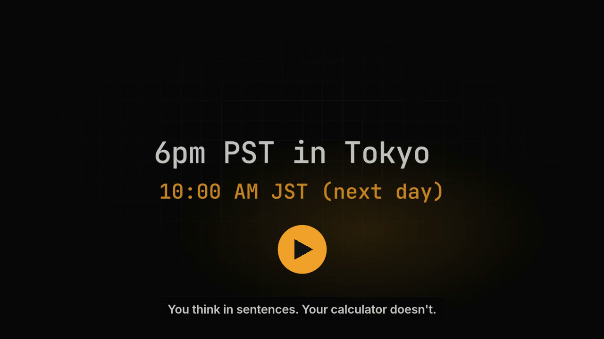

# Omacus

*Oh-mah-kus.* A notepad calculator for Omarchy, Linux, macOS and Windows.
**[omacus.com](https://omacus.com)** · [Try it in your browser](https://app.omacus.com) · [Docs](https://omacus.com/docs/) · [Download](https://omacus.com/download/)

[](https://omacus.com/#video)

Type on the left, results appear on the right.

```
Rent: $1,450                         $1,450
Groceries $320 + $85                   $405
Internet €40 in USD                  $44.86
total                             $1,899.86

rate = $85/hour                 $85 / hour
rate * 6 hours * 4                   $2,040
prev in EUR                   1,818.97 EUR
```

## What it understands

| | |
|---|---|
| Arithmetic | `2^10`, `sqrt(16)`, `10 mod 3`, `5 x 3`, `10 times 3`, `1.5k` |
| Percentages | `20% of 340`, `5% on 200`, `15% off $1,299`, `$120 as % of $480`, `5% of what is 6`, `18% tip on $62` |
| Splitting | `$84 split 3 ways`, `split $240 between 4 people` |
| Units | `3.5 km in miles`, `2 hours + 45 min in minutes`, `72 fahrenheit in celsius`, `10 GB / 4` |
| Downloads | `4 GB at 100 Mbps` → `5 min 20 s`, `700 MB @ 10 MB/s` |
| Currency | `$30 in EUR`, `€50 + £20 in USD`, `£250 in USD` (live rates, cached 12h) |
| Variables | `rent = $1200`, then `rent * 12` |
| Page words | `prev`, `sum`/`total`, `avg`/`average` (over the lines since the last blank line or header). `sum(1, 2, 3)`, `avg(2, 4)`, `min(...)` and `max(...)` take arguments; a comma inside the call separates them, and `1,000` outside a call is still one thousand |
| Dates | `today`, `now`, `tomorrow + 2 weeks`, `now - 90 minutes` |
| Counting days | `days until Dec 25`, `weeks until Christmas`, `days since Jan 1`, `workdays in November`, `days between Mar 1 and Jun 30` |
| Time zones | `6pm PST in Tokyo`, `time in Sydney`, `now in London`, `10:30 London to New York`, `3pm PST in IST` |
| Bases | `255 in hex`, `0xff in decimal`, `255 in binary` |
| CSS & colours | `16px in rem`, `12pt in px`, `#ff8800 in rgb`, `rgb(51, 102, 153) in hex`, `hsl(150, 60%, 45%)` (with a swatch) |
| Notes | `# Header`, `// comment`, `#` later on a line is a comment drawn in the comment colour, `"quoted text"`, `Label: 40`, stray prose is ignored. A list prefix comes off first: `- hotel = 3 nights * $180` |

Math, units and currency come from [fend-core](https://github.com/printfn/fend); `src/engine.rs`
adds the notepad conventions on top.

## Using it

- On Omarchy, `SUPER + CTRL + ALT + =` opens Omacus (or focuses it), floating and centered.
- `Ctrl+Q` or `Ctrl+W` quits. `Esc` only closes the page switcher, the preview, help, settings, or a dialog. Nothing is ever lost: like Sublime Text, every page is saved as you
  type and reopens exactly where you left it, cursor included.
- Click a result to copy it (a short note confirms); `Ctrl+Shift+C` copies the last result, and `Ctrl+Shift+S` copies
  the whole page with its answers lined up (`Ctrl+Shift+M` as a Markdown table). Hover a variable or a number such as `1.5k` to see its value. A name you define, a later use of it, and keywords or units are three different colours.
- `Ctrl` `+` / `-` zooms. `Ctrl+,` opens Settings (a tab in the same window as About), and so does the gear at the bottom of the sidebar. `Ctrl+\` hides the answers column, so each answer sits after its line. `Ctrl+P` previews the page as rendered notes: each source line stays its own line, blank lines stay blank, comments stay on the line, and each answer sits in a right-hand column (or after the line, when that column is hidden). Print and Export PDF use that view.
- Settings picks the theme. Auto follows your `theme.toml`, then the active Omarchy theme (live on `omarchy theme set`), then the system's light or dark mode. Light, Dark, Paper and Dusk are built in.

### Pages

| Key | |
|---|---|
| `Ctrl+N` | New page |
| `Ctrl+J` | Go to a page by name |
| `Ctrl+Alt+↑` / `Ctrl+Alt+↓` | Previous / next page |
| `Ctrl+Tab` / `Ctrl+Shift+Tab` (or `Ctrl+PgDn` / `PgUp`) | Next / previous page |
| `Ctrl+1` … `Ctrl+9` | Jump to page |
| `Alt+↑` / `Alt+↓` | Move page up / down |
| `Ctrl+Shift+Delete` | Delete page (asks first; moved to `trash/`, restored from Recently deleted) |
| `Ctrl+B` | Expand or collapse the sidebar |
| `Ctrl+Shift+L` | Copy a share link to the page |
| `Ctrl+,` | Settings: theme, answers column, export folder, update checks (also the gear at the bottom of the sidebar) |
| `Ctrl+\` | Hide the answers column |
| `Ctrl+P` | Preview the page (print and export PDF from there) |

The ⋯ above a page (or on its row in the sidebar, or a right-click) has the same actions, and Settings. The gear at the bottom of the sidebar (and of the collapsed strip) opens Settings too, and so does typing `settings` in the page switcher (`Ctrl+J`). Settings lives in the same window as About, Keyboard, Syntax and Tips. Export PDF writes `Page title.pdf` into Downloads, or a folder chosen in Settings. If that file is already there, Omacus asks before replacing it. A page's title is its first line.
Pages are plain text in `~/.local/share/omacus/pages/`; order, cursors, and whether the
sidebar is expanded (and how wide) are in `~/.local/share/omacus/state.json`.
A folder named `sheets` from an older version is renamed to `pages` the first time this version opens.
A deleted page opens read-only from Recently deleted; Restore and Delete forever are explicit.

### Sharing and the web app

**Share** above a page (or `Ctrl+Shift+L`) copies a link like
`https://app.omacus.com#v1.…` that opens the page, live, in [Omacus in the browser](https://app.omacus.com).
The page is compressed into the part after `#`, which browsers never send to a server, so it isn't
uploaded anywhere; anyone with the link can read it.

Open a shared page in the app with **Open in Omacus** on the web page (`omacus://` links are
registered by the installer, the macOS app, and Windows on first run), by pasting the link into any
page, or with `omacus open '<link>'`. It opens as a new page, or switches to it if you have it.

The web app runs the same engine (`engine/`, compiled to WebAssembly from `web/`). Its pages are
saved in that browser; export and import them as a `.zip` of `.txt` files. It installs as an app
and works offline. Exchange rates stay cached for 12 hours; if a refresh does not succeed, the
page says rates may be stale.

### Autocomplete

Suggestions for variables, units, keywords and time zones appear as you type, each with its kind and a short description.
`Tab` accepts, `↑`/`↓` choose, `Esc` dismisses. `Enter` inserts a newline. `Ctrl+Space` opens the suggestions on purpose, and then `Enter` accepts the chosen one, so `3 km in` followed by Enter still cannot turn into `inch`.

CLI:

With no arguments, `omacus` opens the window. A bare expression still prints one answer.

```sh
omacus '3.5 km in miles'                         # 2.17 miles
omacus eval '3.5 km in miles'
omacus eval --json '2 + 2'                       # one JSON object per line
printf 'a = 5\na * 3\n' | omacus eval            # a whole page, one answer per line
printf 'a = 5\na * 3\n' | omacus -               # the same, the short form
omacus pages list
omacus pages show 'Trip Budget'                  # the page, with answers
omacus pages new 'Weekend Plans'
omacus pages new Groceries --from-file list.txt
omacus pages append Groceries 'milk $3'
omacus pages rm 'Weekend Plans'                  # moved to Recently deleted
omacus pages export 'Trip Budget' --md           # a Markdown table on stdout
omacus pages export 'Trip Budget' --pdf          # a PDF in the export folder
omacus --version
omacus update                                    # install the latest version
omacus open '<link>'                             # open a shared page
omacus completions bash                          # also zsh, fish, powershell
```

A page can be named by its title, its id, or a unique prefix (`trip` is enough for
Trip Budget). If more than one page fits, omacus lists them and changes nothing.
`omacus eval` with no expression reads stdin; on a terminal it asks for one.
`omacus pages --help` lists every page command.

The command line uses the same pages as the window (`pages/` under the data folder
in the table below). The window re-reads them every few seconds, and again when it
regains focus, so an edit made here shows up in the app. Set `OMACUS_DATA_DIR` to
use a different folder.

A locked page is not printed, exported, or changed unless you pass `--password`.

### MCP

`omacus mcp` is a [Model Context Protocol](https://modelcontextprotocol.io) server
on stdin and stdout, for Claude Desktop, Cursor, and anything else that speaks MCP.
It evaluates expressions and reads and writes the same pages. `delete_page` moves a
page to Recently deleted. A locked page is not returned without its password.

Claude Desktop (`claude_desktop_config.json`) and Cursor (`.cursor/mcp.json`, in the
project or in your home directory) take the same block. `omacus` needs to be on
`PATH` (the installers put it there):

```json
{
  "mcpServers": {
    "omacus": {
      "command": "omacus",
      "args": ["mcp"]
    }
  }
}
```

On macOS the config file is `~/Library/Application Support/Claude/claude_desktop_config.json`.
On Linux it is `~/.config/Claude/claude_desktop_config.json`. On Windows it is
`%APPDATA%\Claude\claude_desktop_config.json`. Restart the client after saving it.

## Install

Omacus runs on **Omarchy**, any **Linux**, **macOS** and **Windows**. [What's new](https://omacus.com/updates/)
lists each release in plain words. The [latest release](https://github.com/avinashjoshi/omacus/releases/latest)
has the downloads for each platform.

### Omarchy

One line installs the app with its launcher entry and icon:

```sh
curl -fsSL https://omacus.com/install | bash
```

It then offers to add a keybind and a floating-window rule to your Hyprland config. The suggested
key is `SUPER + CTRL + ALT + =`; pick any other and it's checked against your existing bindings
first, so nothing of Omarchy's gets overridden. If your keyboard has a Calculator key, it can
open Omacus too. Your config files are backed up, nothing is added twice, and changes are rolled
back if Hyprland reports an error.

For unattended installs, pass the answer instead:

```sh
curl -fsSL https://omacus.com/install | bash -s -- --hyprland                 # default key
curl -fsSL https://omacus.com/install | bash -s -- --key "SUPER + ALT + N"    # your key
curl -fsSL https://omacus.com/install | bash -s -- --no-hyprland              # leave Hyprland alone
```

Colors follow your Omarchy theme and switch with it.

### macOS

```sh
curl -fsSL https://omacus.com/install | bash
```

Installs `Omacus.app` into Applications (Apple Silicon and Intel) and opens without a security
prompt. Or with Homebrew:

```sh
brew install --cask avinashjoshi/tap/omacus
```

Or download the .dmg for your chip ([omacus.com/download](https://omacus.com/download/#mac)) and drag Omacus to
Applications; the app isn't notarized yet, so the first time, open it once, then go to
**System Settings → Privacy & Security** and click **Open Anyway**
(or run `xattr -dr com.apple.quarantine /Applications/Omacus.app`).

### Windows

In PowerShell:

```powershell
irm https://omacus.com/install.ps1 | iex
```

Or download [the installer](https://github.com/avinashjoshi/omacus/releases/latest/download/omacus-windows-x86_64-setup.exe)
and open it. Omacus installs for your user (no admin prompt) into `%LOCALAPPDATA%\Programs\Omacus`,
appears in Start and opens; `omacus 2+2` works in a new terminal. It isn't signed yet, so a
downloaded installer may get a SmartScreen warning: choose **More info → Run anyway** (the
PowerShell line doesn't get one). Uninstall from **Settings → Apps**; your pages are kept.

No installer: [`omacus-windows-x86_64.zip`](https://github.com/avinashjoshi/omacus/releases/latest/download/omacus-windows-x86_64.zip)
holds a single portable `omacus.exe`.

It works from a terminal too: `omacus.exe "$100 in EUR"`.

### Ubuntu / Debian

```sh
curl -fsSLO https://github.com/avinashjoshi/omacus/releases/latest/download/omacus-linux-x86_64.deb
sudo apt install ./omacus-linux-x86_64.deb
```

### Fedora / openSUSE

```sh
sudo dnf install https://github.com/avinashjoshi/omacus/releases/latest/download/omacus-linux-x86_64.rpm
```

### Arch and any other Linux

Install for your user, no root needed, into `~/.local/bin` with a launcher entry:

```sh
curl -fsSL https://omacus.com/install | bash
```

Or download [`omacus-linux-x86_64.tar.gz`](https://github.com/avinashjoshi/omacus/releases/latest/download/omacus-linux-x86_64.tar.gz),
unpack it and run `./install.sh`. Prebuilt Linux binaries are x86_64; on ARM, build from source.

### From source

Any platform with [Rust](https://rustup.rs):

```sh
git clone https://github.com/avinashjoshi/omacus && cd omacus
./install.sh                   # Linux: builds (under a minute) and installs for your user
cargo run                      # or just run it: a quick debug build
```

`cargo build --release` makes the smallest binary, the way releases are built; its last
step optimizes the whole program on one core and can sit at the final crate for a few
minutes.

On other desktops, bind a global shortcut to `omacus` in your keyboard settings.

### Where things live

| | Linux | macOS | Windows |
|---|---|---|---|
| Pages | `~/.local/share/omacus/pages` | `~/Library/Application Support/omacus/pages` | `%APPDATA%\omacus\pages` |
| Custom theme | `~/.config/omacus/theme.toml` | `~/Library/Application Support/omacus/theme.toml` | `%APPDATA%\omacus\theme.toml` |
| Settings | `~/.config/omacus/settings.toml` | `~/Library/Application Support/omacus/settings.toml` | `%APPDATA%\omacus\settings.toml` |

Colors: Settings (`Ctrl+,`) chooses the theme. Auto uses your `theme.toml` if present (Omarchy `colors.toml` format), else the active Omarchy theme, else the system's light or dark mode. Light, Dark, Paper and Dusk ignore those files. Omarchy and Custom use only that one source. `Ctrl+\` hides the answers column. On macOS, shortcuts use ⌘ wherever this README says Ctrl.

### Updating

The version sits at the bottom of the sidebar, with a dot when a new one is out; click it to update
and restart. About (F1) has a Check for updates button, or run `omacus update`. Omacus checks GitHub for the latest version when it starts (at most once an hour) and every
4 hours while open;
`check_for_updates = false` in `settings.toml`, or the switch in Settings, turns that off. On Windows it swaps in the new `omacus.exe`
where it is. Installed from a .deb or .rpm, the notice links to the download instead.

## Feedback and issues

Found a wrong answer, a crash, or something Omacus should understand?
[Open an issue](https://github.com/avinashjoshi/omacus/issues/new/choose). For calculations,
paste the exact line you typed and what you expected; that's usually all it takes to fix.
Ideas and feature requests are welcome too, and so are pull requests.

## Releasing

Write the notes first, under `## Unreleased` in [`CHANGELOG.md`](CHANGELOG.md): a short title
in bold, then one or two sentences for someone using Omacus. The voice is in
[`docs/DESIGN.md`](docs/DESIGN.md).

Run the [Release workflow](.github/workflows/release.yml) (Actions → Release → Run workflow)
and leave the action on `prepare`. It opens a pull request that bumps `version` in `Cargo.toml`
and renames that section to the version. Auto-merge has to be allowed, and these checks have to be
required on `main`: `test (ubuntu-22.04)`, `test (windows-latest)`, `test (macos-latest)`, and
`wasm`. The pull request merges when they pass. The workflow then tags `v<version>`, builds
every package, and publishes a GitHub release from those notes, plus install links
([`release-notes.sh`](.github/scripts/release-notes.sh)).

If `## Unreleased` is missing, the pull request drafts notes from commit subjects, and CI
rejects them. Notes that are only commit titles, or that mention pull requests, CI, or other
plumbing, fail [`tests/check_release_notes.py`](tests/check_release_notes.py).

Action `build` packages the current `main` without opening a pull request.

## License

[MIT](LICENSE) © 2026 Avinash Joshi. The bundled JetBrains Mono font is under the
[SIL Open Font License](assets/fonts/OFL.txt).
